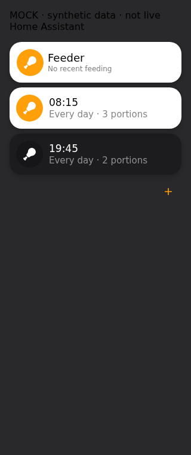

# Tuya Feeder Card

A touchscreen Home Assistant card for the device-owned daily schedule exposed by [Tuya Feeder](https://github.com/myevit/tuya-feeder). Version **0.2.4** uses integration **0.2.1** for the last-feeding timestamp; integration 0.2.0 remains compatible with schedule/manual controls but has no global feeding timestamp.

The transparent wrapper contains independent standard-theme surfaces: one optional manual-feed container and a tile for each meal. A meal's **left icon circle** immediately toggles its enabled state. Its **time/title and subtitle** open a Home Assistant-native meal dialog. No separate right-hand switch, global Save or persistent status footer is shown.

## Synthetic previews

These screenshots render the built card with synthetic fixtures and mock transport; they are not a live installation or physical acceptance test. Native-dialog acceptance uses real installed HA components separately.




## HACS installation

1. Install/configure the Tuya Feeder integration.
2. In HACS → Custom repositories add `https://github.com/myevit/tuya-feeder-card` as **Dashboard**.
3. Download a release and let HACS add its module resource. Refresh after an update; avoid duplicate resources.
4. Add **Tuya Feeder** with the visual editor, selecting its schedule sensor.

```yaml
type: custom:tuya-feeder-card
entity: sensor.feeder_meal_plan
title: Feeder
icon: mdi:food-drumstick
manual_feed: true
portions_entity: input_number.feeder_portions # optional existing helper
```

The integration owns discovery, validation, transport and confirmation. This card creates no feeding automations and never imports raw datapoints.

## Meals and native dialogs

- The icon circle is a separate accessible switch-button. One tap sends one `update_meal` at the current reported revision, without opening an editor or adding a confirmation/global Save. Keyboard activation has the same isolation. Activity/color uses the actual reported enabled state, not a draft or optimistic setting.
- The title/body opens time, portions and enabled fields in native `ha-dialog`/`ha-form` controls. Every-day operation remains the supported repeat mode. **Save** closes the dialog and sends one meal operation. Cancel, Escape, the native X and available backdrop dismissal discard drafts and send nothing.
- **+** opens the same native Add dialog with a disabled meal at 23:59 and one portion. At the device limit (at most ten), adding is disabled.
- **Delete** changes the native shell to a destructive Cancel/Delete confirmation. Only the final Delete sends a logical deletion.
- A restored plan requires explicit **Use saved plan?** acknowledgement before editor Save/Delete. Direct icon intent supplies strict acknowledgement only with validated restored-write capability. Invalid, uncertain, unsupported and stale plans remain blocked.
- Inline **Saving…** remains until real handler completion plus a newer genuine matching report. A command/service ACK alone is not success. No persistent Saved/source/status footer is rendered.
- Editor failure retains the draft. **Try again** reopens it; only a new explicit Save can resend. Toggle failure returns to actual reported state with a plain error. Nothing automatically retries. A concurrent plan change invalidates the dialog and requires Reload.
- Unknown/malformed/unavailable schedules stay explicitly unavailable, never falsely loaded.

### Frontend compatibility boundary

This uses HA's real dialog shell, native form selectors and native footer/buttons, not a hand-made overlay or Browser Mod. The `show-dialog` event and HA component tags are **internal frontend APIs**, not a supported arbitrary-field extension of a sensor's stock more-info dialog. The adapter is verified against frontend **20260930.3** (HA 2026.10). It reuses controls already loaded by Lovelace and, if needed, the built-in entities-card editor loader. If required native components are unavailable, it reports an error and sends nothing; it does not silently substitute an imitation overlay.

After a frontend update, reverify shell lifecycle, selector/context requirements and show-dialog routing. Primary version-pinned sources: [dialog shell](https://github.com/home-assistant/frontend/blob/20260930.3/src/components/ha-dialog.ts), [dialog manager](https://github.com/home-assistant/frontend/blob/20260930.3/src/dialogs/make-dialog-manager.ts), [form](https://github.com/home-assistant/frontend/blob/20260930.3/src/components/ha-form/ha-form.ts), and [time selector](https://github.com/home-assistant/frontend/blob/20260930.3/src/components/ha-selector/ha-selector-time.ts). Unit tests use explicitly labeled native-control doubles; separate acceptance rendered the actual installed frontend components, including zero-write Escape/X/backdrop/Cancel and an explicit one-call Save. That acceptance is mock transport, not a physical feeding test.

## Last feeding

The subtitle uses the integration's persistent `last_feed_at`: `Last fed 12:00`, `Last fed yesterday · 17:30`, or `Last fed Oct 12 · 17:30`, formatted in HA's configured timezone. Unknown/invalid/future timestamps show **No recent feeding**.

This is the most recent **observed local feeding activity** (audited DP4 inactive→feeding event), irrespective of whether initiated by the device schedule, physical button, app or HA. It is not inferred from DP1 schedule receipt, helper edits, script history, command ACK, DP14's cached portions or HA attribute timestamps. It does not independently prove food delivery. Feeding while HA/local transport is offline cannot be observed; an initial cached snapshot is not dated as a new feed. No historical date is invented when upgrading.

### Meal icons and Add meal

Tap the identity icon in the header to open **Add meal** in Home Assistant’s native form. It never feeds; opening or cancelling sends no service call. There is no separate Add +. The portions −/+ and separate confirmed Feed action are unchanged. The identity remains visible but disabled if the plan is unavailable, an operation is pending, or ten meals already exist. A new meal stays disabled until explicitly enabled.

Meal icons default to scheduled local time of day: morning 05:00–10:59 (`mdi:weather-sunset-up`), daytime 11:00–15:59 (`mdi:white-balance-sunny`), evening 16:00–20:59 (`mdi:weather-sunset-down`), and night otherwise (`mdi:weather-night`). These are fixed local HH:MM boundaries, not timezone conversions. The meal icon still toggles only that meal; its title opens Edit. To use a fixed glyph instead:

```yaml
meal_icon_mode: fixed
meal_icon: mdi:clock-outline
```

`meal_icon_mode` and `meal_icon` are available in the visual editor. `icon` controls only the header identity in time-of-day mode. In fixed mode, an omitted `meal_icon` falls back to `icon`, then `mdi:food-drumstick`.

`appearance.icon_color` / `--feeder-icon-color` sets a shared icon palette independently of `accent_color` (Feed). It falls back to the theme’s `--color-teal`, then the existing accent. Active icons use that palette for their circle with a white glyph; inactive icons use the palette for the glyph with a transparent circle. Existing explicit header/active icon overrides retain precedence.

### Manual feeding

The manual surface has one icon/title/subtitle identity followed by minus/count/plus and **Feed**. `feed_title`/`feed_icon` remain deprecated fallback aliases; explicit title/icon win. Only controls actuate; the outer wrapper is inert.

Changing portions never feeds. **Feed** opens native confirmation of the exact captured dose; Cancel/Escape/X/backdrop send nothing. **Feed now** sends one `tuya_feeder.feed`. The backend enforces 1–60 portions, duplicate/uncertain guards and no automatic retry. Feed request success is not asserted as physical delivery.

Feed is disabled without `supports_manual_feed`. Existing helper selection/bounds remain intact: use authoritative HA increment/decrement, never rewrite helper configuration. Use integer step 1 with bounds within 1–60. Without a helper the count is card-session-local. Missing/out-of-range values are not silently clamped.

## Appearance

No card-mod or external frontend dependency is required. Each meal uses a 45px icon circle, 17px medium time/title, 15px subtitle and 69px minimum surface height. Touch targets are at least 44px. Active surfaces use white, black title, gray subtitle and accent circle/white icon; inactive surfaces use the standard dark translucent surface, white title, muted subtitle and dark icon circle. Meal activity is individual; the manual-feed surface is active if any valid reported meal is enabled. The outer wrapper remains transparent.

Optional single-property `appearance` values reject CSS/HTML/URL injection:

```yaml
appearance:
  accent_color: var(--accent-color)
  border_radius: 20px
  font_family: system-ui
  header_font_size: 18px
  meal_time_font_size: 17px
  row_background: rgba(0, 0, 0, 0.3)
  card_background: rgba(0, 0, 0, 0.3)
  control_size: 44px
```

Stable host variables: `--feeder-accent-color`, `--feeder-border-radius`, `--feeder-font-family`, `--feeder-header-font-size`, `--feeder-meal-time-font-size`, `--feeder-row-background`, `--feeder-card-background`, `--feeder-control-size` (44px minimum). Row/card backgrounds customize inactive meal/feed surfaces; they no longer paint the outer wrapper. Additional hooks: `--feeder-outer-background` (transparent), `--feeder-feed-background`, `--feeder-header-icon-background`, `--feeder-header-icon-color`, `--feeder-active-card-background`, `--feeder-active-text-color`, `--feeder-active-muted-color`, `--feeder-active-icon-background`, `--feeder-active-icon-color`. Active defaults are white/black/gray/accent/white. Native dialog controls use HA's own theme, not card-local appearance overrides.

Shadow parts: `card`, `header`, `manual-feed`, `header-icon`, `title`, `subtitle`, `meal`, `row`, `meal-time`, `meal-button`, `enabled`, `control`, `add`, `status`. `data-active` describes manual-surface activity; each row has `data-enabled`. Optional existing card-mod can override these without backend changes; no card-mod is imported or required.

## Service contract

- `update_meal`: `{entity_id, expected_revision, meal_index, meal}`
- `add_meal`: `{entity_id, expected_revision, meal}`
- `delete_meal`: `{entity_id, expected_revision, meal_index}`
- `feed`: `{entity_id, portions}`

Meal: `{days: [all seven lowercase names], time: "HH:MM", portions: integer, enabled: boolean}`. Indices are zero-based. Restored operations add strict `acknowledge_restored_snapshot: true` only after explicit editor acknowledgement or permitted direct icon intent. Backend merges preserve untouched records. The legacy integration `set_schedule` remains compatible but this card does not call it.

## Development

```sh
npm ci
npm run build
npx playwright install chromium
npm test
python3 scripts/check_public.py
```

`CHROMIUM_PATH` may select installed Chromium. CI verifies deterministic TypeScript/build, browser safety/interaction, public-data hygiene, HACS and actual paired HA handler/state contracts. The bridge resolves its mocked service Promise only after the real HA harness handler finishes, so matching attributes alone cannot finish Save. Public fixtures are synthetic; tests/install issue no physical feeds or live schedule writes.
