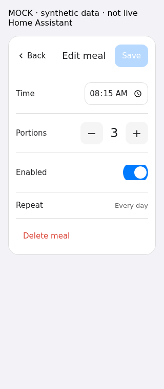

# Tuya Feeder Card

A touchscreen Home Assistant card for the device-owned daily schedule exposed by [Tuya Feeder](https://github.com/myevit/tuya-feeder). Version **0.2.0** requires integration **0.2.0** for per-meal operations and optional manual feeding.

The list has large meal times, independent enable switches and a compact **+** in the header. Tapping a meal replaces the list **inside the card**. **Save** closes the editor and sends one meal operation. **Back**, Escape or Cancel discards the edit without sending anything. There is no popup, second confirmation for an ordinary Save, or global schedule draft.



## HACS installation

1. Install the Tuya Feeder integration and configure its local feeder transport.
2. In HACS → Custom repositories, add `https://github.com/myevit/tuya-feeder-card` as **Dashboard**.
3. Download the latest release and let HACS add its JavaScript module resource. Refresh the dashboard after an update; avoid duplicate resources.
4. Add **Tuya Feeder** with the visual editor, selecting the integration's schedule sensor.

```yaml
type: custom:tuya-feeder-card
entity: sensor.feeder_meal_plan
title: Feeder schedule
icon: mdi:calendar-clock
```

The integration owns discovery, schedule decoding, transport and confirmation. This card does not create feeding automations, duplicate a device schedule or import arbitrary raw datapoints.

## Editing meals

- Tap a meal for time, portions, enabled status and read-only **Every day**. Other weekday combinations are not advertised as supported.
- The list switch opens the same editor with the changed switch value. Nothing is sent until **Save**.
- **+** opens a new, disabled meal at **23:59**, with **one portion**. Cancel sends nothing. At the device's meal limit (at most ten), adding is disabled.
- **Delete meal** replaces the editor with an in-card Cancel/Delete confirmation. Confirmed Delete sends one logical deletion.
- When using a restored plan, explicitly check **Use saved plan?** before Save/Delete. The backend acknowledgement gate remains in force.
- During confirmation the list shows **Saving…** and conflicting actions are disabled. A service ACK alone is not success. **Saved** requires handler completion and a newer, genuine received matching plan.
- Failure retains the edited meal. **Try again** reopens that edit; only another explicit Save can resend. Nothing automatically retries. A revision change while editing requires Reload and blocks stale indices.
- Unknown, malformed, unsupported or unavailable schedules show **Schedule unavailable** with Retry; they never appear successfully loaded.

The front of the card deliberately omits revision numbers, provenance and technical warnings. Debug failures are logged to the browser console. A locally received schedule is not an active cloud query or proof that food physically dispensed. The integration remains the safety authority, including restored-plan acknowledgement and uncertain transport handling.

## Optional manual feeding

```yaml
type: custom:tuya-feeder-card
entity: sensor.feeder_meal_plan
manual_feed: true
feed_title: Feeder
feed_icon: mdi:food-drumstick
portions_entity: input_number.feeder_portions  # optional existing persistent helper
```

This adds one inline icon/title, minus/count/plus and **Feed** row. Only the separate controls are clickable. Changing portions never feeds. **Feed** opens an in-card confirmation of the exact dose; Cancel sends nothing and the second **Feed** sends one `tuya_feeder.feed` call. The backend validates 1–60 portions and rejects duplicate/uncertain requests. The UI says **Feed requested**, not that food physically dispensed.

The row is off by default and its Feed action is disabled unless the integration advertises `supports_manual_feed`. With a helper, existing selection and bounds are preserved: increments/decrements use Home Assistant's authoritative `input_number.increment`/`decrement`, never overwrite helper configuration or create/reset a helper. Use an integer helper with step 1 and bounds within 1–60. Without a helper the count is local to this card session. Missing or out-of-range helper values are not silently clamped into a feed request.

## Appearance and visual editor

The built-in layout needs **no card-mod**, imports or separate frontend dependency. It inherits HA primary/text/card/divider colors, radius, shadow and font. The header uses standard 18px medium text, a 25px icon in a 45px circle and a separate 44px Add control; the optional manual row is 68px tall with 15px text. The default large meal time is 32px. All independent touch controls are at least 44px.

The visual editor includes the following optional `appearance` fields. Values are single CSS property values, not stylesheets, HTML or URLs. Invalid/injection-like values are rejected.

```yaml
appearance:
  accent_color: var(--primary-color)
  border_radius: 20px
  font_family: system-ui
  header_font_size: 18px
  meal_time_font_size: 32px
  row_background: rgba(128, 128, 128, 0.06)
  card_background: var(--ha-card-background)
  control_size: 48px
```

| Field / stable CSS variable | Default |
| --- | --- |
| `accent_color` / `--feeder-accent-color` | HA `--primary-color` |
| `border_radius` / `--feeder-border-radius` | HA `--ha-card-border-radius`, else 20px |
| `font_family` / `--feeder-font-family` | HA body font, else system-ui |
| `header_font_size` / `--feeder-header-font-size` | 18px |
| `meal_time_font_size` / `--feeder-meal-time-font-size` | 32px |
| `row_background` / `--feeder-row-background` | Theme text tint at 4.5% |
| `card_background` / `--feeder-card-background` | HA card background |
| `control_size` / `--feeder-control-size` | 44px minimum |

Additional CSS-only hooks: `--feeder-header-icon-background` (accent) and `--feeder-header-icon-color` (HA text-primary color). Avoid extreme font/control sizes on narrow dashboards; 44px remains the minimum hit target.

Stable shadow parts: `card`, `header`, `title`, `meal`, `row`, `meal-time`, `meal-button`, `switch`, `stepper`, `control`, `save`, `add`, `manual-feed`, `status`. Theme/custom CSS can target, for example, `tuya-feeder-card::part(title)` or `tuya-feeder-card::part(save)` without relying on internal class names.

### Optional card-mod

If card-mod is **already installed**, its normal `ha-card`/`hui-card` support can apply `card_mod` styles to this card. No special import/bootstrap or backend manifest dependency is needed. Existing `card_mod` configuration is preserved by the visual editor. Example:

```yaml
type: custom:tuya-feeder-card
entity: sensor.feeder_meal_plan
card_mod:
  style: |
    :host, ha-card {
      --feeder-meal-time-font-size: 36px;
      --feeder-row-background: rgba(128, 128, 128, 0.08);
    }
```

Appearance options and HA themes are the simplest route and work without card-mod. Card-mod's [developer guide](https://github.com/thomasloven/lovelace-card-mod/blob/master/README-developers.md) documents `applyToElement` for custom elements that need explicit attachment; this card contains `ha-card` and uses the standard supported automatic attachment instead. See also [application rules](https://github.com/thomasloven/lovelace-card-mod/blob/master/README-application.md). CSS custom-property and shadow-part overrides are exercised against the actual bundled component in Chromium; screenshots are synthetic, not authenticated live-dashboard captures.

## Service contract

- `update_meal`: `{entity_id, expected_revision, meal_index, meal}`
- `add_meal`: `{entity_id, expected_revision, meal}`
- `delete_meal`: `{entity_id, expected_revision, meal_index}`
- `feed`: `{entity_id, portions}`

Meal: `{days: [all seven lowercase weekday names], time: "HH:MM", portions: integer, enabled: boolean}`. Indices are zero-based. Restored schedule operations include `acknowledge_restored_snapshot: true` only after the explicit checkbox. The backend merges the logical meal operation into its current full plan, preserves other rows and performs the full-DP encoding. The legacy integration `set_schedule` service remains compatible but the v0.2 card does not use it.

## Development and verification

```sh
npm ci
npm run build
npx playwright install chromium
npm test
python3 scripts/check_public.py
```

`CHROMIUM_PATH` may point to an existing Chromium executable. CI verifies TypeScript/build determinism, browser safety/interaction tests, public-data hygiene, HACS validation and the paired integration's actual HA service/state contract. The bridge defers the mocked frontend service Promise until the HA harness reports real handler completion; matching state alone cannot falsely finish a Save. All test devices, plans and screenshots in this repository are synthetic; no physical feed or live schedule write is part of tests or installation.
