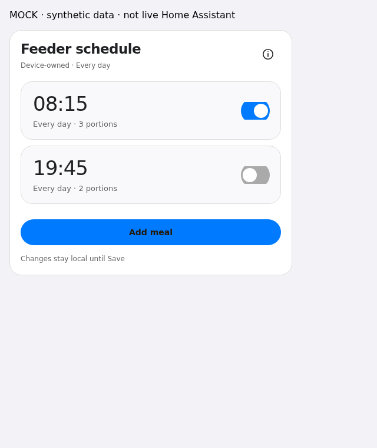

# Tuya Feeder Card

A compact Lit dashboard card for **device-owned daily meal plans**. This card is not a feeder integration and offers **no Feed action** or Home Assistant recurring-feed automation. Pair it with [Tuya Feeder](https://github.com/myevit/tuya-feeder).

## Synthetic preview



This image renders only invented test data in an isolated browser. It contains no real household schedule, device configuration or live capture.

## Install

In HACS, add `https://github.com/myevit/tuya-feeder-card` as a custom **Dashboard** repository, then download Tuya Feeder Card. This repository is not claimed to be in the default HACS store. Reload the frontend and, if necessary, add `/hacsfiles/tuya-feeder-card/tuya-feeder-card.js` as a JavaScript module resource. Manual installation: download the release asset into `www/tuya-feeder-card.js`, add `/local/tuya-feeder-card.js` as a module resource, and reload the browser. No HA core restart is required for a card resource.

```yaml
type: custom:tuya-feeder-card
entity: sensor.example_feeder_schedule
title: Feeder schedule
icon: mdi:calendar-clock
```

The visual card editor provides a sensor selector, title and icon. All examples and browser test fixtures are synthetic. The card inherits Home Assistant theme variables including `--primary-color` for the Save accent.

## Safety and editing

- Large-time rounded meal tiles open an Edit meal sheet (time, portions, enabled, Every day). Independent switches do not open the sheet. Delete is red inside the sheet with local confirmation; there are no permanent Edit/Delete controls. Only the meal button is clickable, not the parent/card. Stepper buttons and switches have at least 44px touch targets. All changes remain local.
- New rows default to **disabled**, every day, **23:59**, **one portion**. Limit: 10 meals and 1–60 integer portions, additionally constrained by the sensor's advertised limits. Each time must be HH:MM in 24-hour format.
- Save opens a real keyboard-accessible modal listing the **entire replacement plan**, including disabled rows. Cancel, Escape, and Reset draft call no services. Untouched rows are preserved in the payload.
- Save appears only while dirty; a draft reverted to the observed plan removes Save and calls no service. Only Confirm Save calls `tuya_feeder.set_schedule`, exactly once. While awaiting confirmation the whole draft container is inert and duplicate saves are blocked.
- An empty service acknowledgement is **not success**. Successful service-handler completion **and** a matching validated locally received snapshot with a strictly increased integer revision, a new receive timestamp, and `pending: false` clear busy. A matching report arriving before the handler finishes cannot conceal a subsequent stale-revision rejection. A transient error while backend `pending` remains true does not unlock the controls. Terminal errors require explicit reload. If HA sends no terminal state, a 20-second frontend watchdog preserves the draft, blocks retries until explicit reload, and reports uncertainty; it never infers success or retries automatically.
- A changed revision during an unsaved draft blocks Save; explicitly Reload schedule to discard the draft. No silent overwrite.
- Unknown/unavailable, invalid or unconfirmed snapshots, unsupported weekday subsets and missing write capability are read only. Legacy `days: Everyday` strings display read only when write support is absent. First release supports only all seven weekdays, not weekday-specific schedules.

## Integration contract

Use integration **v0.1.2+** with card **v0.1.3+** for historical import editing. Older integration v0.1.1 remains supported for genuinely received states only. Attributes: `meals`, `revision` (positive safe integer), `last_received_at` (parseable nonempty ISO receive timestamp), `schedule_valid: true`, `snapshot_source: received`, `pending: false`, `error` empty/null, `supports_schedule_write: true`, `supported_days_mode: every_day`, integer `max_meals`, integer `max_portions`. `meals` is an array of objects containing `days`, `time`, integer `portions`, boolean `enabled`; `days` must contain each of `monday, tuesday, wednesday, thursday, friday, saturday, sunday` exactly once. No inferred meals or fabricated current snapshots. `observation_kind` remains the integration’s descriptive last-locally-reported warning and is not a machine confirmation flag. Restored snapshots become draft-editable only with explicit `supports_restored_schedule_write: true` and `requires_restored_snapshot_acknowledgement: true`. Confirm Save shows the original received date and overwrite warning, then sends strict `acknowledge_restored_snapshot: true` for that one replacement. A saved snapshot never confirms a write. A receipt is not an active GET and unreported external-app edits may still be stale; technical provenance and warnings are behind the information button. Unknown remains blocked until an administrator selects a passive source in integration options and calls Import snapshot. No frontend bootstrap fabricates events.

The only service payload is:

```json
{"entity_id":"sensor.example_feeder_schedule","expected_revision":7,"meals":[{"days":["monday","tuesday","wednesday","thursday","friday","saturday","sunday"],"time":"23:59","portions":1,"enabled":false}]}
```

The sensor is the confirmation authority. This release intentionally ignores positive service response ACKs and waits for incoming attributes; service errors are displayed. The integration must perform its own revision, validation and transport safety checks. Hardware-dependent schedule support is not guaranteed by installing this frontend.

## Build and test

Node 22+, `npm ci`, `npm run build`, `npx playwright install --with-deps chromium`, `npm test`. Optional `CHROMIUM_PATH` selects an already installed isolated Chromium. Tests exercise the **actual bundled card in Chromium DOM** with a mocked hass object, including confirmation, exact payload, zero-service drafts, cancellation, stale revisions, fail-closed validation, bounds, editor events and 640/320px screenshots. Browser artifacts are explicitly mock UI, not a live HA dashboard. CI validates HACS and builds/tests on the exact pushed commit. Version 0.1.3 uses a self-contained `dist/tuya-feeder-card.js` release asset (Lit bundled; no CDN runtime).

Sources: [HACS plugin requirements](https://www.hacs.xyz/docs/publish/plugin/), [HA custom card API](https://developers.home-assistant.io/docs/frontend/custom-ui/custom-card/), [Lit components](https://lit.dev/docs/components/overview/).

## Cross-package acceptance gate

Both repositories' CI run `tuya-feeder/tests/test_card_contract.py` against the built card using `tests/integration_bridge.mjs`. The fixture is generated at test runtime from actual `hass.states` and a synthetic HA config entry/device, not hand-authored attributes. Real Chromium renders that state, captures one Confirm Save payload, and the real HA action handler validates it. An intercepted LocalTuya service supplies genuine synthetic inbound DP events; pending and matching-receipt transitions drive the same browser. Unknown, unsafe restored, corrupt, mixed-day, disconnected, timeout and edit-conflict states fail closed. No household fixture or live schedule is used.

Locally, build the card, install the integration test requirements, then from the integration checkout run `TUYA_FEEDER_CARD_DIR=/path/to/tuya-feeder-card .venv/bin/pytest -q tests/test_card_contract.py` (optionally set `CHROMIUM_PATH`). CI records both checked-out commit IDs. No physical feeding or production deployment is asserted by this gate.

## Privacy / deployment

No household identifiers, real schedules, HA configuration, credentials, device keys, network addresses or private captures belong here. Do not commit exported production snapshots. Installing or publishing this repo does not authorize modifying an existing dashboard, feeder plan, integration or restarting Home Assistant. MIT licensed.
